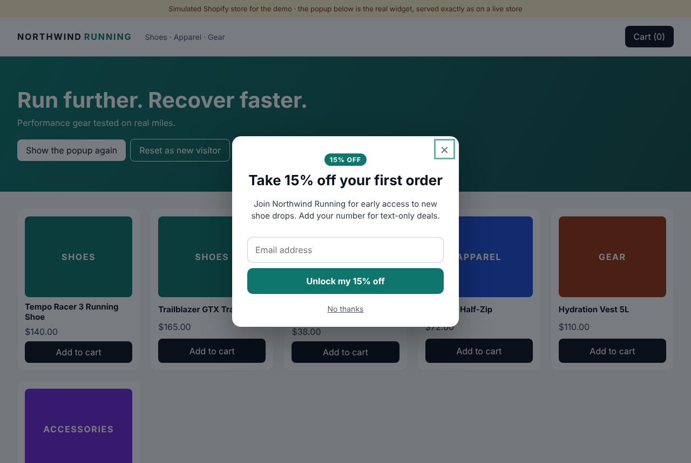
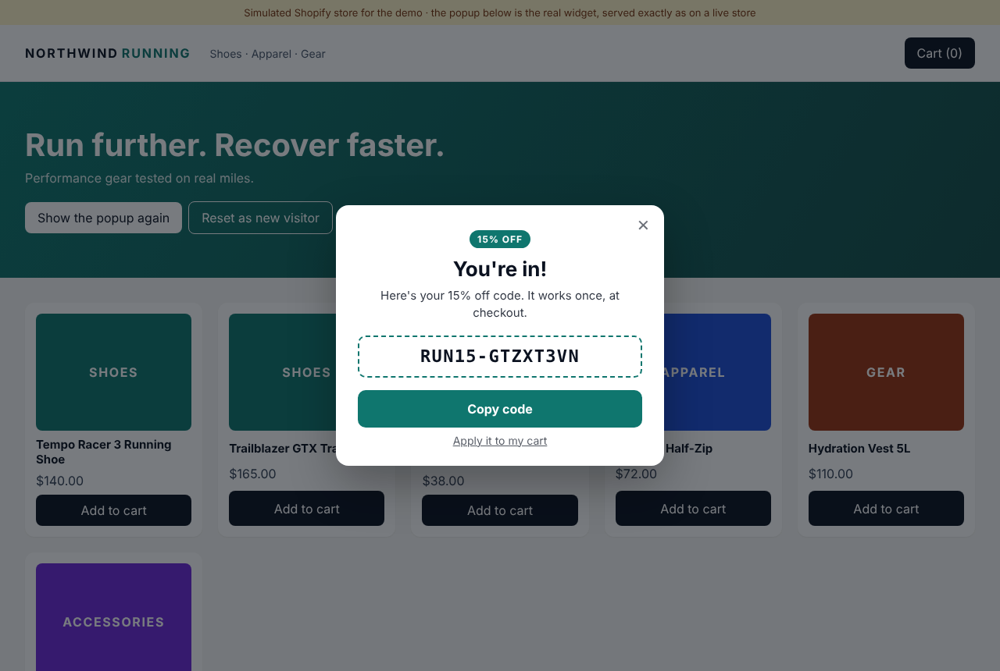
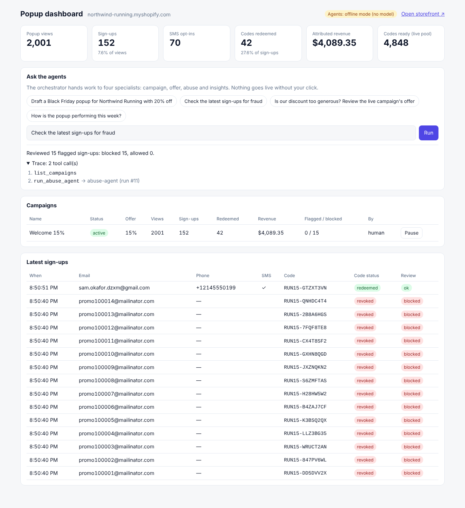
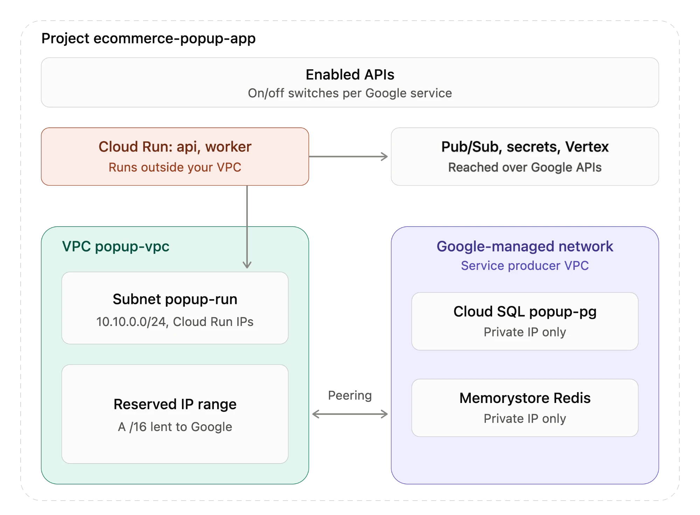

# ecommerce-popup-app

An email and SMS capture popup for Shopify storefronts, with the backend behind it:

- **React popup** that renders on top of the store, collects an email and (optionally) a mobile number with SMS consent, and reveals a unique, single-use discount code.
- **Node.js API** that issues codes at **10,000 requests/second**, stores every sign-up in **PostgreSQL**, and marks codes redeemed when Shopify reports the order.
- **Shopify app**: OAuth install, a theme app extension that injects the popup, discount creation through the Admin API, and signed webhooks for redemption. The demo runs against a **simulated Shopify store** that behaves the same way (it validates codes at checkout and sends signed `orders/create` webhooks).
- **Four Claude agents and an orchestrator** (Claude on **Vertex AI**): they design campaigns, tune the discount, review sign-ups for abuse and answer performance questions.
- **GCP deployment**: Terraform for Cloud Run, Cloud SQL, Memorystore, Pub/Sub, Secret Manager, Artifact Registry and GCS, plus Cloud Build.

> Independent demo project. The store "Northwind Running" and its products are fictional.

| Popup on the storefront | Code revealed | Merchant dashboard |
|---|---|---|
|  |  |  |

## Architecture

```
 Storefront (Shopify theme)                                   Merchant dashboard (React)
   └─ theme app extension loads popup.js (GCS/CDN)               └─ /admin API ──► orchestrator agent ──► 4 specialist agents
        │                                                                                │ tools: read stats, write drafts,
        ▼                                                                                │ propose offers, revoke codes
 ┌──────────────────────── Cloud Run: popup-api (autoscaled, ROLE=api) ───────────────────┴─────────┐
 │ GET  /v1/popup/config   campaign from process memory (10 s) → Redis (60 s) → Postgres             │
 │ POST /v1/popup/submit   validate → ONE Redis round trip (Lua): IP velocity, same-email dedupe,    │
 │                         pop a pre-created code → publish sign-up event → respond                  │
 │ POST /v1/popup/events   views/closes: Redis counter + event                                       │
 │ POST /webhooks/*        verify Shopify HMAC → dedupe by webhook id → publish → 200                 │
 └──────────────┬─────────────────────────────────────┬───────────────────────────────────────────────┘
                │ Memorystore Redis                    │ Pub/Sub "popup-events" (at-least-once, DLQ)
                │ code pools · dedupe · counters       ▼
                │                       ┌──── Cloud Run: popup-worker (ROLE=worker, always on) ────┐
                └──────────────────────►│ batch writer: one multi-row INSERT per batch → Postgres   │
                                        │ pool refiller: mint codes in Postgres + Shopify → Redis   │
                                        │ abuse agent every minute over flagged sign-ups            │
                                        └───────────────────────────┬───────────────────────────────┘
                                                                    ▼
                                                     Cloud SQL Postgres (signups, codes, campaigns)
```

### How it reaches 10,000 requests/second

The shopper-facing request never waits on Postgres, Shopify or a model:

1. **Codes are created ahead of time.** The worker keeps each live campaign's pool of codes topped up in Redis. A code only enters the pool after Shopify has accepted it, so it's redeemable the moment it's shown.
2. **One Redis round trip per sign-up.** An atomic Lua script does the per-IP rate limit, returns the same code to an email that already has one, and pops a fresh code. Atomicity means no code is ever issued twice, even under heavy concurrency.
3. **Write-behind to Postgres.** The API publishes the sign-up to Pub/Sub and responds. The worker writes batches of up to 1,000 rows in one `INSERT … SELECT unnest(…)` statement. Database load grows with batches, not requests, and every write is idempotent (`ON CONFLICT`) because delivery is at-least-once.
4. **The hottest read is served from process memory.** The campaign config is cached in-process for 10 s, then in Redis, then in Postgres.

**Measured** (`loadtest/bench.mjs`, a single Node process on a 4-vCPU VM that was also running Postgres, Redis, the worker and the load generator):

| Run | Throughput | p50 / p99 latency | Errors | Codes issued twice |
|---|---|---|---|---|
| 20 s, 100 connections | **9,980 req/s** | 8 ms / 24 ms | 0 of 199,593 | 0 |
| 30 s, 100 connections | **8,791 req/s** | 9 ms / 39 ms | 0 of 263,700 | 0 (across 463,510 sign-ups) |

On Cloud Run, each 2-vCPU instance carries a few thousand sign-ups per second (plus about 1 ms of network to Memorystore). The Terraform defaults (2 minimum, 60 maximum instances, 250 concurrent requests each) cover 10k/s with headroom. `loadtest/k6-popup.js` ramps a deployed API to 10k/s and holds it for 5 minutes, with error-rate and latency thresholds.

**What the benchmark showed:** at a sustained ~9k sign-ups/s, the pool drained faster than codes could be minted on that shared box. The API then created codes inline, with one shared mint per process rather than one per request, so requests kept succeeding. Real Shopify rate-limits code creation as well. So in production, size the pool for the peak (`pool_target`, 100k by default: about ten seconds at 10k/s), pre-fill it before a planned drop, and alert on pool depth.

## The agents

The agents use a manual tool-use loop on the Claude Messages API (`@anthropic-ai/sdk`, `AnthropicVertex` client). None of them is on the shopper's path, and nothing they do goes live without a person: drafts need **Activate**, and offers need **Apply**.

| Agent | Tools | What it does |
|---|---|---|
| **Campaign** | `get_store_profile`, `get_campaign_history`, `save_campaign_draft` | Turns a brief ("Black Friday, 20% off") into popup copy, a discount and theme colours, saved as a draft |
| **Offer** | `get_campaign_stats`, `get_offer_history`, `propose_offer` | Balances list growth against margin; refuses to act on thin data; moves in 5-point steps, clamped to 5–30% |
| **Abuse** | `list_flagged_signups`, `get_signup_context`, `record_verdict` | Reviews sign-ups that cheap rules flagged (disposable domains, IP bursts, scripted clients); blocking revokes the code before it's used. Also runs every minute in the worker |
| **Insights** | `get_campaign_stats`, `get_daily_series` | Answers questions about performance with the real numbers |
| **Orchestrator** | `list_campaigns`, `run_*_agent` | Routes a merchant request to one or more specialists (in parallel when independent) and combines the answers |

- **Model:** `claude-opus-5-5` (change with `CLAUDE_MODEL`). Tools use `strict: true` schemas, and the code clamps numbers anyway.
- **Effort:** `medium` for the planners, `low` for the abuse and insights agents.
- **Fallback:** if the model declines a request, the SDK's refusal-fallback middleware retries it on `CLAUDE_FALLBACK_MODEL` (Vertex has no server-side fallback).
- **Audit trail:** every run is stored in `agent_runs` with its tool calls, and the dashboard shows the trace.
- **Offline mode:** with `LLM_PROVIDER=offline` (the default), each agent runs a deterministic policy over the **same tools**, so the demo works without GCP credentials. The dashboard badge shows which mode is active.

## Campaign schedules and signed-in customers

**Schedules.** Campaigns are created by asking the agents on the dashboard, in plain words: "Welcome 20% on Nov 20", "Welcome 20% off for 15 days starting tomorrow", "Draft a Black Friday popup with 20% off". The campaign agent drafts the popup with its schedule: *always on* (no dates given), *a specific date*, or *N consecutive days*. Days run midnight to midnight in the merchant's time zone, which the dashboard sends with each request. Nothing goes live until the merchant clicks **Schedule** (or **Activate** for always-on).

**Pause and remove.** Every campaign has **Pause** (stop showing, keep it) and **Remove**:

- A campaign no shopper got a code from is deleted, and its Shopify discount is switched off.
- One with sign-ups is archived instead: hidden from the list, its results kept in the totals, and codes already sent still work.

- A scheduled campaign takes over from the always-on campaign during its dates; afterwards the always-on one shows again. Two scheduled campaigns can't overlap.
- Its Shopify discount gets the same `startsAt` / `endsAt`, so its codes only work during those dates.
- The config cache expires exactly when a schedule starts or ends, and the worker fills a scheduled campaign's code pool an hour before it starts.

**Signed-in customers.** Guests still see the popup after a delay or on exit intent. A signed-in customer sees it on the screen they land on right after signing in, greeted by name, with the account email already filled in:

- On Shopify, the theme block passes `{{ customer.email }}`, `{{ customer.first_name }}` and `{{ request.page_type }}`. The popup opens on the account page (`customers/account`) once per browser session.
- Single-page storefronts call `window.PopupApp.identify(customer, { postLogin: true })` after sign-in and `identify(null)` after sign-out. The demo store does this; it has simulated customer accounts (sign in, create an account, order history).
- A customer who already got this offer's code, or dismissed it in the last 24 hours, isn't shown it again.

## Shopify integration

| Piece | Where |
|---|---|
| App config, scopes, webhook subscriptions (incl. mandatory privacy webhooks) | `shopify-app/shopify.app.toml` |
| Theme app extension (app embed that loads `popup.js` with `data-shop`) | `shopify-app/extensions/popup-embed/` |
| OAuth install and callback (HMAC + state check, encrypted offline token) | `api/src/routes/oauth.ts` |
| Discount creation and bulk code add (Admin GraphQL) | `api/src/shopify/client.ts` (`AdminApiShopifyClient`) |
| Webhooks: HMAC over the raw body, dedupe by `X-Shopify-Webhook-Id`, enqueue | `api/src/routes/webhooks.ts` |
| Simulated store: catalogue, customer accounts, checkout, signed `orders/create` | `api/src/routes/mockShopify.ts`, `web/src/demo/` |

`SHOPIFY_MODE=mock` (the default) uses the simulated store. `SHOPIFY_MODE=real` uses the Admin API, which needs a Partner app and a development store. The GraphQL field names in real mode follow the discount API and haven't been run against a live store; check them against `SHOPIFY_API_VERSION` first.

## Run it locally

**With Docker** (Docker Desktop on a Mac):

```bash
docker compose up --build
open http://localhost:8080/demo/        # storefront: the popup appears after ~2.5 s
open http://localhost:8080/dashboard/   # merchant dashboard (token: demo-admin-token)
```

**Without Docker** (Node 22, Postgres 16 and Redis 7 running locally):

```bash
npm install
createuser -s popup && createdb -O popup popup   # or point DATABASE_URL at your own database
npm run build -w web
npm run dev -w api                      # API + worker on :8080
```

**Claude on Vertex AI** instead of offline agents:

```bash
gcloud auth application-default login
LLM_PROVIDER=vertex GCP_PROJECT=<your-project> npm run dev -w api
```

The project must have Claude enabled in Vertex AI Model Garden.

**Useful commands:**

```bash
npm test                                # 22 unit + integration tests (needs Postgres and Redis)
npm run simulate -w api -- 2000         # 2,000 visitors of realistic traffic plus a bot burst
npm run reset-demo -w api               # wipe and reseed the simulated store
node loadtest/bench.mjs http://localhost:8080 20 100   # throughput benchmark
```

## Demo script (about 7 minutes)

1. **Reset and fill the store.** With the API stopped, run `npm run reset-demo -w api`. Then start the API and run `npm run simulate -w api -- 2000`.
2. **Storefront.** Open `/demo/`. The popup appears on top of the store: enter an email, then a phone number with consent, and get a code. Click **Apply it to my cart**, then **Pay now**; the order total shows the discount. To see the popup again as a brand-new visitor, open `/demo/?reset`: it clears this browser's popup history and sign-in, then reloads the store.
3. **Redemption.** In `/dashboard/`, the new sign-up's code shows **redeemed**. The simulated Shopify store sent a signed `orders/create` webhook, and the worker matched the code.
4. **Reuse is blocked.** Use the same code at checkout again: Shopify (simulated) rejects it as already used. Sign up again with the same email: you get the same code back, not a second one.
5. **Agents.** Click each chip in **Ask the agents** and open the trace:
   - **Fraud:** the abuse agent blocks the bot burst and revokes those codes.
   - **Discount:** the offer agent reads the funnel and keeps or proposes a change.
   - **Black Friday:** the campaign agent writes a draft; **Activate** it and reload the storefront to see it live.
6. **Scale.** Show the benchmark table above and walk through the hot path in `api/src/lib/pool.ts` (the Lua script) and `api/src/worker.ts` (the batch writer).
7. **GCP.** Walk through `infra/terraform/main.tf`: the two Cloud Run services from one image, private Redis and Postgres, Pub/Sub with a dead-letter topic, per-service service accounts and Vertex AI access.

## Deploy to GCP

```bash
cp infra/terraform/terraform.tfvars.example infra/terraform/terraform.tfvars   # optional
./scripts/gcp-deploy.sh <project-id> us-central1
```

The script:
1. Creates the registry.
2. Builds the image with Cloud Build.
3. Applies the Terraform.
4. Sets the app's public URL.
5. Publishes `popup.js` to the widget bucket.

The dashboard asks for the admin token the first time it's opened on a deployment. Paste the output of `gcloud secrets versions access latest --secret popup-admin-token`; the browser keeps it until you click **Sign out**. Locally the token is `demo-admin-token`, which the dashboard uses on its own.

After that, `gcloud builds submit --config cloudbuild.yaml --substitutions=_TAG=$(git rev-parse --short HEAD)` rebuilds and redeploys both services.

### Network layout



Cloud SQL and Redis have private IPs only. Both run in a Google-managed network that is peered with `popup-vpc` through a reserved /16 range (Private Services Access). Cloud Run runs outside the VPC and joins it through the `popup-run` subnet using Direct VPC egress. With `PRIVATE_RANGES_ONLY`, only traffic to private `10.x` addresses goes through the VPC. Pub/Sub, Secret Manager and Vertex AI are public Google APIs secured by IAM, so Cloud Run calls them directly.

**Agents on GCP** use Claude on Vertex AI. New projects usually start with no quota for Claude models, so agent runs fail with a 429 until you request an increase (Console → IAM & Admin → Quotas, `global_online_prediction_requests_per_base_model` for `anthropic-claude-opus`). Until then, set `llm_provider = "offline"` in `terraform.tfvars` and apply; the agents run their built-in rules, as they do locally.

**Cost:** the defaults (HA Cloud SQL, Standard HA Redis, two warm API instances) are sized for production. For a demo, set `api_min_instances = 0`, `db_high_availability = false` and `deletion_protection = false`, and tear down afterwards:

```bash
terraform -chdir=infra/terraform destroy -var project_id=<project-id> -var deletion_protection=false
```

The last network resources can fail to delete at first: the subnet stays in use until Cloud Run releases its IP (1–2 hours), and the peering stays in use for a while after Cloud SQL is deleted. They cost nothing; run `destroy` again later.

## Design decisions worth discussing

- **Why pre-minted pools rather than generating codes on request?** A code must exist in Shopify before the shopper sees it. Creating it inline would put Shopify's latency and rate limits on every request.
- **Why write-behind?** The source of truth for "which code went to whom" is the atomic Redis operation; Postgres is the durable record, filled within about a second. A crash between the two is covered by Pub/Sub redelivery and idempotent writes.
- **Why rules on the hot path but an agent off it?** The rules cost microseconds and never block a real customer. The agent has the context to tell a bot from a busy office network, and it can still revoke a code before it's used.
- **Why human approval for agent actions?** Discounts are money. Agents draft and propose; people activate and apply. Every run is logged with its tool calls.
- **Why a shadow DOM for the popup?** Merchant themes have arbitrary CSS; isolation keeps the popup's styles and the theme's styles out of each other.
- **PII:** emails and phones live only in Postgres (encrypted at rest by Cloud SQL). Redis holds hashes. Shopify access tokens are AES-256-GCM encrypted with a key from Secret Manager. Customer and shop redact webhooks delete data.

## Not done yet

- **Popup bundle size:** the bundle is 70 KB gzipped because it includes React. Aliasing `react` to `preact/compat` would cut it to about 15 KB without code changes.
- **Dashboard auth:** the dashboard uses a single bearer token. An embedded Shopify app would use App Bridge session tokens.
- **Tables to partition:** `signups` and `popup_events` should be partitioned by month at real volume.
- **Not yet verified in this build:** the Docker image build and `terraform validate` (the build environment blocked the npm and Terraform registries from inside containers). CI runs both.
